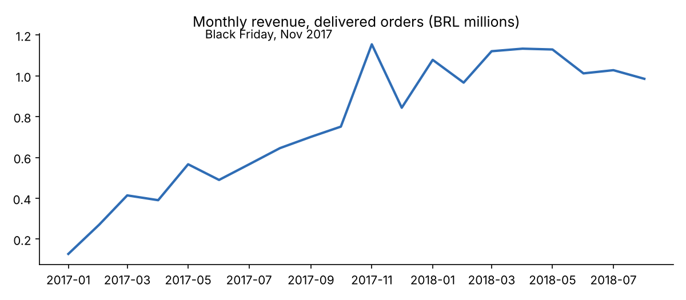
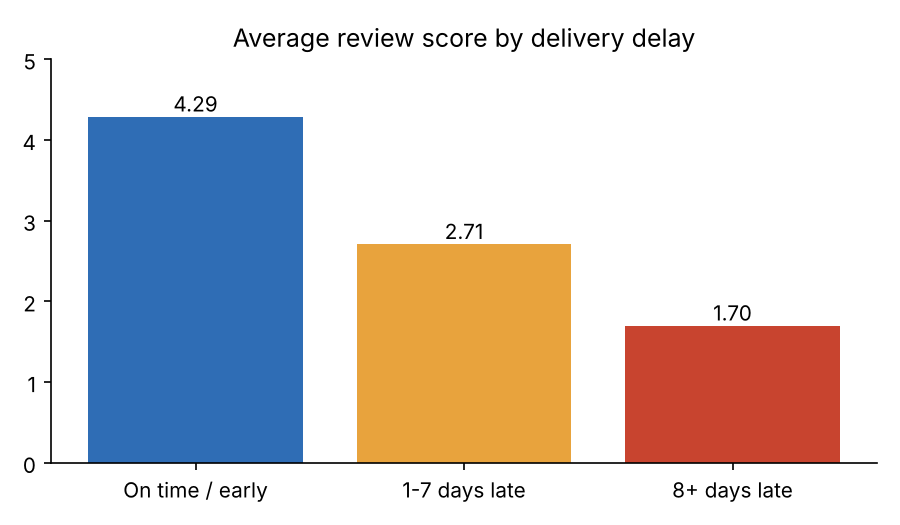
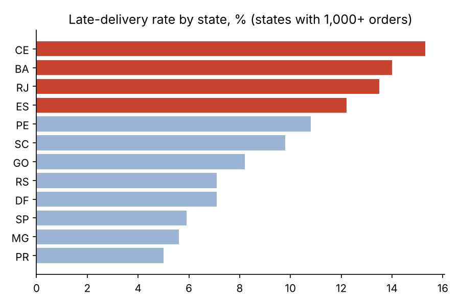

# E-commerce customer & delivery analytics (Olist, Brazil)

**Business question:** Why do customers leave unhappy and rarely come back, and what should the business fix first?

**Data:** [Olist Brazilian E-Commerce](https://www.kaggle.com/datasets/olistbr/brazilian-ecommerce) (also on GitHub: olist/work-at-olist-data). 99,441 orders, 9 relational tables, Sep 2016 to Aug 2018.
**Tools:** SQL (DuckDB, standard SQL: joins, CTEs, window functions `LAG`, `NTILE`, `ROW_NUMBER`), Python (pandas, matplotlib).

## How to run
1. Download the 9 CSVs from [Kaggle](https://www.kaggle.com/datasets/olistbr/brazilian-ecommerce) (or the [olist/work-at-olist-data](https://github.com/olist/work-at-olist-data/tree/master/datasets) GitHub repo) into a `data/` folder, then `pip install -r requirements.txt`.
2. Run `sql/00` to `sql/06` in order in DuckDB (`duckdb` CLI or Python), or in Postgres after swapping `read_csv_auto` for `COPY`.
3. `python charts.py data` produces the 3 charts.

## Data quality checks (sql/00)
- 99,441 orders, no duplicate order IDs. Reviews: 99,224 rows for 98,673 orders, so some orders have 2+ reviews. Handled by keeping the latest review per order (`ROW_NUMBER`).
- 8 orders marked delivered with no delivery date and 1 order with no payment were excluded from the delivery analysis. 610 products have no category, labelled "unknown".
- `customer_id` is per order. Repeat-purchase analysis uses `customer_unique_id`.

## Charts

## Findings
1. **Late delivery destroys ratings.** On-time orders average 4.29 stars. Orders 1-7 days late average 2.71, and 8+ days late average 1.70, with 79% of those giving 1-2 stars. Only 6.7% of orders are late, but they drive a large share of bad reviews.
2. **Lateness is regional.** Rio de Janeiro (RJ) has 12,350 orders and a 13.5% late rate, versus 5.9% in São Paulo (SP). CE and BA are worst (15.3%, 14.0%) with 19-21 day average delivery.
3. **Almost nobody comes back.** Only 3.0% of 93,358 customers placed a second delivered order.
4. **Revenue is concentrated.** RFM segmentation shows the two high-value segments are 19% of customers but 51.5% of revenue. "High value, at risk" alone is 8% of customers and 21.8% of revenue.
5. **Growth plateaued.** Monthly revenue grew from BRL 0.13M (Jan 2017) to a BRL 1.15M Black Friday peak (Nov 2017), then held around BRL 1.0-1.1M through 2018.

## Recommendations
1. Fix logistics for RJ, BA and CE first (carrier review, more realistic delivery estimates). This is where volume and lateness overlap.
2. Win back the "High value, at risk" segment (7,502 customers, avg spend BRL 447) with a targeted campaign, since repeat business is near zero.
3. Track late-delivery rate and repeat rate as weekly KPIs, alongside revenue.

## Limitations
Correlation, not proven causation: late orders may also differ by product or seller. Next step would be controlling for category and seller.
